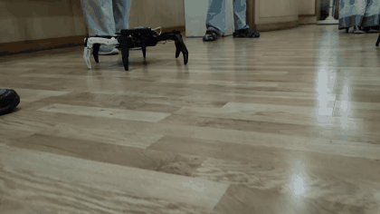
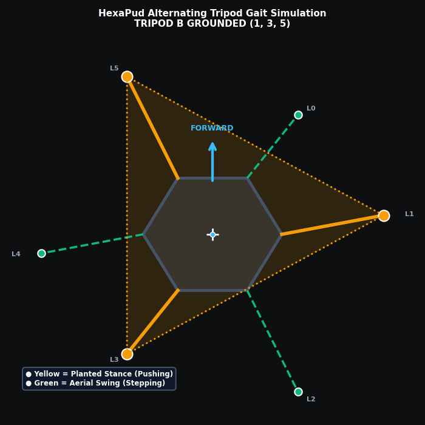
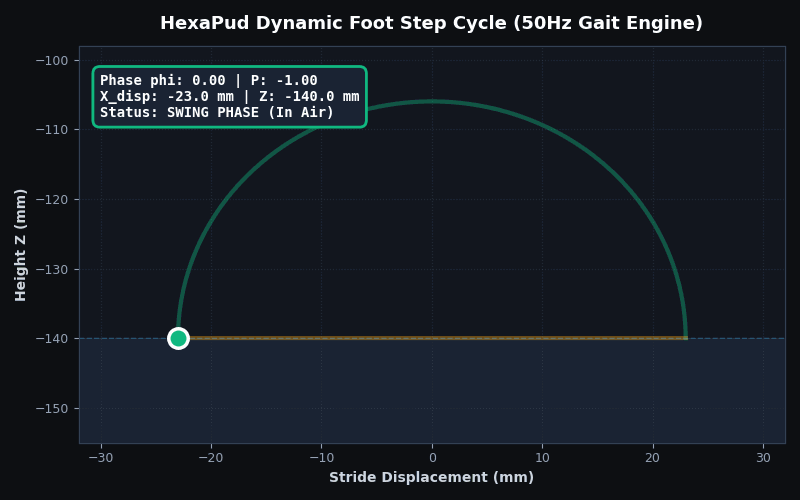
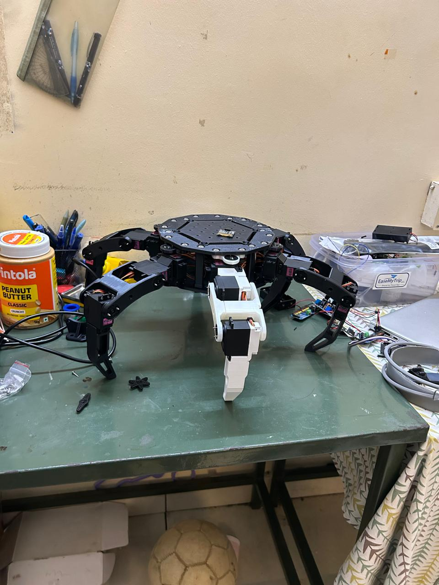
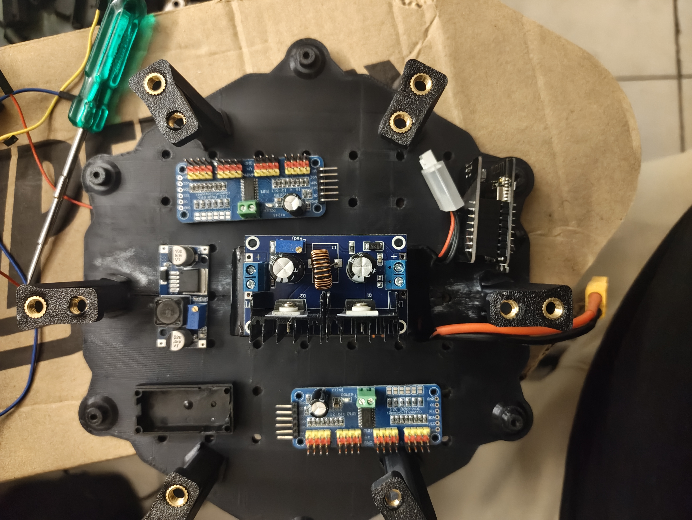
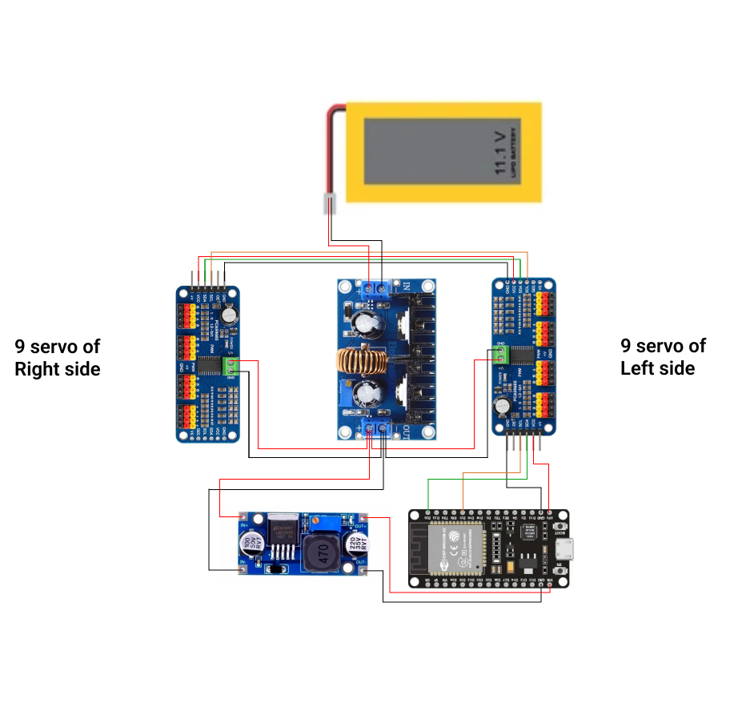

# HexaPud

[](https://micropython.org/)
[](https://www.espressif.com/)
[](LICENSE)
[](#team--contributions)

An open-source, 18-DOF biomimetic hexapod robot driven by an ESP32 microcontroller running MicroPython. Features analytical 3-DOF geometric inverse kinematics, 8-way omnidirectional vector walking, dual-mode morphing (6-legged hexapod $\leftrightarrow$ 4-legged quadruped mantis crawl), and a self-hosted Wi-Fi web cockpit.

---

## Demonstrations

|         Physical Robot Walking Test         |        Simulated Tripod Gait Support Triangles        |          3D Parametric D-Loop Step Trajectory          |
| :-----------------------------------------: | :---------------------------------------------------: | :----------------------------------------------------: |
|  |  |  |

> **Video Logs** (in [`docs/media/`](docs/media/)):
> - [First Walking Test (`hexapod walks for the first time.mp4`)](docs/media/hexapod%20walks%20for%20the%20first%20time.mp4): Initial untethered walking validation run.
> - [Kinematics Testing (`testing phase.mp4`)](docs/media/testing%20phase.mp4): Single-leg range verification and servo torque check.

---

## Key Features

- **Analytical 3-DOF Geometric Inverse Kinematics**: Closed-form trigonometric solver using `atan2` and the Law of Cosines running at sub-millisecond execution times on the ESP32.
- **8-Way Omnidirectional Locomotion**: 2D coordinate rotation matrices transform global pilot heading vectors into local coordinate frames for each of the 6 radially mounted legs.
- **Dual-Mode Morphing**:
  - **6-Leg Hexapod Mode**: Alternating tripod gait with synchronized stance push and parabolic aerial swing.
  - **4-Leg Quadruped Mode**: Folds middle legs into an elevated mantis posture while outer legs execute a wide diagonal crawl.
- **Extended Kinematic Range**: Safe joint motion envelopes (Coxa: $50^\circ-130^\circ$, Femur: $30^\circ-150^\circ$, Tibia: $30^\circ-150^\circ$) enabling long $65\text{mm}$ strides and $46\text{mm}$ ground clearance.
- **Non-Blocking 50Hz Real-Time Event Loop**: Socket polling using `select.poll(0)` enables instantaneous emergency halt without FreeRTOS scheduler latency.
- **Standalone Wi-Fi Web Cockpit**: Self-hosted Access Point (`HexaPud-Bot` on `192.168.4.1`) serving a responsive control interface with an 8-way latching virtual joystick, chassis elevation adjustment ($\pm 65\text{mm}$), and live speed profiles.

---

## 3D Printed Structure & Our CAD Redesign

We got our initial 3D printable files from [Sir-Kuhnhero's Hexapod repository](https://github.com/Sir-Kuhnhero/Hexapod) on GitHub, which gave us a solid starting point. But as undergraduate students on a tight budget, we hit a practical problem right away: our local 3D printing service charged us per gram of plastic. 

Printing 18 leg segments using the original solid files would have driven up our 3D printing costs. So before sending anything to the printer, we brought the parts into CAD and modified them:

- **Hollowing out the Tibia (Lower Leg)**:
  The original design used a 2-piece tibia that had to be bolted together, and it was mostly solid plastic. We redesigned the tibia into a single printable piece and scooped out the non-critical plastic from the inside. This helped bring down our printing costs and made the leg easier for our knee servos to lift and hold during stances.
  
- **Modifying the Servo Mounts**:
  The MG996R servos we ordered turned out to have a slightly bulkier PCB housing on the back compared to the exact servos the original design used. To avoid forcing or cracking the plastic, we reduced the inner wall thickness of the servo brackets so our servos would slide right in with a snug fit.

- **Why Leg 0 is White**:
  If you notice in the build photos, Leg 0 (Front-Left) is printed in white PLA with a 90° neutral tibia mount, while the other 5 legs are black PLA with a ~75° physical mount. Leg 0 was our very first test print to verify tolerances and servo horn alignment. Rather than wasting plastic reprinting it, we kept it on the robot and neutralized the physical angular difference in software via calibration offsets.

All 3D print files (chassis `.3mf` files and leg `.stl` files) are organized in the [`cad/`](cad/) folder with a complete printing guide.

### Physical Assembly

<p align="center">
  
  &nbsp;&nbsp;&nbsp;&nbsp;
  
</p>

---

## Electronics & Power Setup

Driving 18 metal-gear servos draws heavy current spikes (often 6A to 10A during active walking), which would instantly brown out the ESP32 and cause random restarts if everything ran off the same regulator. To keep the board rock-solid, we split the power coming from our 3S 11.1V LiPo battery (connected via an XT60 plug) into two separate lines:

- **Servo Bus (6V High-Current)**: An XL4016E1 buck converter steps down the battery voltage to a steady 6.0V to power all 18 servos through the two PCA9685 driver boards.
- **Logic Bus (5V Clean)**: A smaller LM2596 buck converter drops the voltage down to 5.0V strictly for the ESP32 logic power.
- **I2C Control**: The ESP32 talks to both PCA9685 boards over I2C (`GPIO 21` SDA, `GPIO 23` SCL). Board #1 (`0x40`) drives the 3 left legs, and Board #2 (`0x41`, with the A0 address pad bridged) drives the 3 right legs.

### Circuit Schematic

<p align="center">
  
</p>

### Bill of Materials (BOM) & Cost Breakdown

The total hardware build cost came out to approximately **₹8,828**, making it an accessible 18-DOF robotics platform.

#### Electronics & Actuation

| Item                             | Specification / Model                  | Qty | Unit Price (INR) |  Total Price (INR)  |
| :------------------------------- | :------------------------------------- | :-: | :--------------: | :------------------: |
| **Servos**                 | MG996R High-Torque Metal Gear Servos   | 18 |     ₹311.00     |      ₹5,597.00      |
| **Battery**                | 11.1V 3S LiPo Battery Pack             |  1  |    ₹1,420.25    |      ₹1,420.25      |
| **PWM Drivers**            | PCA9685 16-Channel 12-Bit I2C Drivers  |  2  |     ₹229.00     |       ₹458.00       |
| **Microcontroller**        | ESP32-WROOM-32 Development Board       |  1  |     ₹350.00     |       ₹350.00       |
| **High-Current Buck**      | XL4016E1 DC-DC Step-Down (6V Servos)   |  1  |     ₹450.00     |       ₹450.00       |
| **Logic Buck**             | LM2596 DC-DC Step-Down (5V ESP32)      |  1  |     ₹135.00     |       ₹135.00       |
| **Wiring**                 | Multi-strand Silicone Hookup Wire (5m) |  1  |     ₹75.00     |       ₹75.00       |
| **Main Connector**         | XT60 Male/Female Power Connector Pair  |  1  |     ₹29.00     |       ₹29.00       |
| **Subtotal (Electronics)** |                                        |    |                  | **₹8,514.25** |

#### Fasteners & Inserts

| Item                           | Specification                      | Length (mm) | Qty | Unit Price (INR) | Total Price (INR) |
| :----------------------------- | :--------------------------------- | :---------: | :-: | :--------------: | :----------------: |
| **Cap Screws**           | M3 Socket / Cup Head               |    6 mm    |  8  |      ₹1.80      |      ₹14.40      |
| **Cap Screws**           | M3 Socket / Cup Head               |    10 mm    | 12 |      ₹2.20      |      ₹26.40      |
| **Cap Screws**           | M3 Socket / Cup Head               |    14 mm    | 12 |      ₹2.20      |      ₹26.40      |
| **Cap Screws**           | M3 Socket / Cup Head               |    20 mm    |  6  |      ₹2.60      |      ₹15.60      |
| **Cap Screws**           | M3 Socket / Cup Head               |    30 mm    | 12 |      ₹3.60      |      ₹43.20      |
| **Countersunk**          | M5 Countersunk Screws              |    10 mm    | 30 |      ₹2.00      |      ₹60.00      |
| **Nuts**                 | M3 Square Nuts                     |     —     | 50 |      ₹0.70      |      ₹35.00      |
| **Threaded Inserts**     | M5 Brass Heat-Set Inserts (OD 7mm) |    5 mm    | 42 |      ₹2.20      |      ₹92.40      |
| **Subtotal (Fasteners)** |                                    |            |    |                  | **₹313.40** |

**Grand Total Hardware Build Cost**: **₹8,827.65**

### Pinout & Wiring

| Interface             |  ESP32 Pin  | Target Device           | Notes                              |
| :-------------------- | :---------: | :---------------------- | :--------------------------------- |
| **I2C SDA**     | `GPIO 21` | PCA9685 #1 & #2 `SDA` | Fast Mode (400kHz)                 |
| **I2C SCL**     | `GPIO 23` | PCA9685 #1 & #2 `SCL` | Fast Mode (400kHz)                 |
| **I2C Addr #1** |     —     | `0x40` (Default)      | Left Legs: 0 (FL), 1 (ML), 2 (BL)  |
| **I2C Addr #2** |     —     | `0x41` (A0 Bridged)   | Right Legs: 3 (BR), 4 (MR), 5 (FR) |

### Leg Channel & Calibration Table

Each leg link has measured lengths: **Coxa ($L_1$) = 51mm**, **Femur ($L_2$) = 80mm**, **Tibia ($L_3$) = 128mm**. Radial chassis mount radius is $\approx 100\text{mm}$.

|  Leg Index  | Position                |  Board  | Coxa Ch | Femur Ch | Tibia Ch |  Mount Angle  |    Direction    |     Saved Offsets [C, F, T]     |
| :---------: | :---------------------- | :------: | :-----: | :------: | :------: | :------------: | :--------------: | :-----------------------------: |
| **0** | Front-Left (White PLA)  | `0x40` |    0    |    1    |    2    | $+30^\circ$ | `[ 1,  1,  1]` | `[ +5.0°, +10.0°,  -3.0°]` |
| **1** | Mid-Left (Black PLA)    | `0x40` |    4    |    5    |    6    | $+90^\circ$ | `[ 1,  1,  1]` | `[  0.0°,  -2.0°, -21.0°]` |
| **2** | Back-Left (Black PLA)   | `0x40` |    8    |    9    |    10    | $+150^\circ$ | `[ 1,  1,  1]` | `[  0.0°,  +5.0°, -15.0°]` |
| **3** | Back-Right (Black PLA)  | `0x41` |    0    |    1    |    2    | $-150^\circ$ | `[-1, -1, -1]` | `[  0.0°, -14.0°,  +3.0°]` |
| **4** | Mid-Right (Black PLA)   | `0x41` |    4    |    5    |    6    | $-90^\circ$ | `[-1, -1, -1]` | `[ -8.0°,  -5.0°, +13.0°]` |
| **5** | Front-Right (Black PLA) | `0x41` |    8    |    9    |    10    | $-30^\circ$ | `[-1, -1, -1]` | `[ -7.0°,  -7.0°,  +4.0°]` |

---

## Kinematics & Software Pipeline

### 1. Vector Projection

When commanded to walk along world vector $\vec{V} = [V_x, V_y]$, the displacement is projected into each leg's local coordinate frame via a 2D rotation matrix:

$$
\begin{bmatrix} X_{\text{local}} \\ Y_{\text{local}} \end{bmatrix} = \begin{bmatrix} \cos(\theta_{\text{mount}}) & \sin(\theta_{\text{mount}}) \\ -\sin(\theta_{\text{mount}}) & \cos(\theta_{\text{mount}}) \end{bmatrix} \begin{bmatrix} V_x \\ V_y \end{bmatrix}
$$

### 2. Parametric Trajectory Generation (D-Loop)

A master clock phase $\phi \in [0.0, 1.0)$ advances at 50Hz. Legs are split into Tripod A ($\phi$) and Tripod B ($(\phi + 0.5) \pmod{1.0}$):

- **Swing Phase ($\phi < 0.5$)**: Foot lifts along a sine arch ($Z(t) = Z_{\text{ground}} + H_{\text{lift}}\sin(\pi t)$) and advances forward via S-curve progress $P \in [-1.0, +1.0]$.
- **Stance Phase ($\phi \ge 0.5$)**: Foot remains pressed flat on the floor ($Z = -140\text{mm}$) pushing backward ($P \in [+1.0, -1.0]$) to drive the chassis forward.

### 3. Inverse Kinematics

Instantaneous $(X, Y, Z)$ foot targets are solved analytically for joint angles:

$$
\theta_{\text{coxa}} = \text{atan2}(Y, X)
$$

$$
d_{\text{horiz}} = \sqrt{X^2 + Y^2} - L_{\text{coxa}}, \quad D = \sqrt{d_{\text{horiz}}^2 + Z^2}
$$

$$
\theta_{\text{tibia}} = \arccos\left(\frac{L_{\text{femur}}^2 + L_{\text{tibia}}^2 - D^2}{2 L_{\text{femur}} L_{\text{tibia}}}\right)
$$

$$
\theta_{\text{femur}} = \text{atan2}(-Z, d_{\text{horiz}}) - \arccos\left(\frac{L_{\text{femur}}^2 + D^2 - L_{\text{tibia}}^2}{2 L_{\text{femur}} D}\right)
$$

---

## Repository Structure

```
HexaPud/
├── cad/                            # 3D printable chassis (.3mf) and leg (.stl) models
│   ├── body/                       # Main chassis plates and spacers
│   └── legs/                       # Right, left (mirrored), and common leg parts
├── firmware/                       # Production ESP32 MicroPython firmware
│   ├── main.py                     # Main controller & Wi-Fi web server
│   ├── pca9685.py                  # I2C 16-channel 12-bit PWM driver
│   └── index.html                  # Standalone web cockpit interface
├── tests/                          # Diagnostic & calibration utilities
│   ├── single_leg_arduino/         # C++ single-leg serial test sketch
│   ├── single_leg_micropython/     # MicroPython single-leg test script
│   └── hexapod_cli_test/           # Headless 18-servo REPL calibration CLI
├── tools/                          # Calibration and flashing utilities
│   ├── calibrate_servo.py          # Interactive single-joint offset calculator
│   ├── drivers/                    # CH341 USB-to-UART drivers
│   └── firmware_bin/               # ESP32 MicroPython binary images
├── docs/                           # Technical documentation & design assets
│   ├── assets/                     # High-resolution diagrams, flowcharts, and GIFs
│   ├── media/                      # Demonstration videos, photos, and walk GIF
│   ├── calibration_offsets.md      # Hardware offset table & joint mapping
│   └── presentation_deck.md        # Technical presentation slide deck
├── .gitignore
├── LICENSE
└── README.md
```

---

## Quickstart

### 1. Flash MicroPython

Flash MicroPython v1.25 onto the ESP32:

```bash
esptool.py --chip esp32 --port COM_PORT erase_flash
esptool.py --chip esp32 --port COM_PORT --baud 460800 write_flash -z 0x1000 tools/firmware_bin/ESP32_GENERIC-20250415-v1.25.0.bin
```

### 2. Upload Firmware

Using **Thonny IDE** (or `mpremote`):

1. Upload `firmware/pca9685.py` to `/pca9685.py`.
2. Upload `firmware/main.py` to `/main.py`.
3. Soft reboot the ESP32 (`Ctrl+D`).

### 3. Connect & Pilot

1. Connect your device to the robot's Wi-Fi network:
   - **SSID**: `HexaPud-Bot`
   - **Password**: `12345678`
2. Open a browser and navigate to `http://192.168.4.1`.

---

## Future Scope

Right now, the robot relies on manual piloting over Wi-Fi, but the hardware and software are structured so we can expand towards full autonomy:

1. **Self-Leveling with an IMU**: Adding an MPU6050 accelerometer/gyroscope to the chassis so the robot can dynamically adjust individual leg heights when walking over slopes or uneven surfaces.
2. **LiDAR & Room Mapping**: Mounting a companion single-board computer (like a Raspberry Pi) with a 2D LiDAR to handle obstacle avoidance, room mapping, and autonomous navigation.
3. **AI Vision & Navigation**: Streaming an onboard camera feed to an AI model that can understand surroundings and issue high-level navigation commands directly to our existing REST API endpoints.

---

## Team & Contributions

This project was built by three roommates collaborating across mechanical, electrical, and software disciplines:

- **[Krishnanshu Agrawal](https://github.com/Krishnanshu06)**: Kinematics derivation, gait generation, locomotion engine, web application cockpit, calibration, and movement testing.
- **[Shreyansh Choudhary](https://github.com/shreyansh10100)**: Electronics architecture, power distribution and regulation (dual buck converters, high-current routing), CAD optimization, and battery management.
- **Utkarsh Rathour**: Mechanical assembly, 3D printing and post-processing, hardware testing, and electrical integration.

*Software architecture and inverse kinematics implementation were developed through AI-assisted pair programming.*

---

## Attribution & Acknowledgments

- **Mechanical Base Design**: The initial structural concept was derived from the open-source [Hexapod](https://github.com/Sir-Kuhnhero/Hexapod) project by **Sir-Kuhnhero**, licensed under the MIT License.
- **Modifications**: All tibias and servo mounting brackets were re-engineered for weight reduction, print cost optimization, and compatibility with specific MG996R servo dimensions.

---

## License

This project is licensed under the [MIT License](LICENSE).
